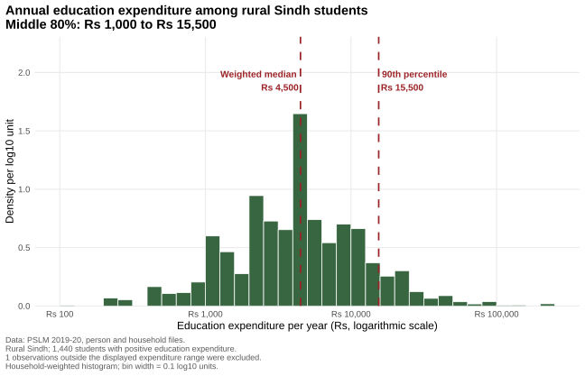

# ECO346-A1-FA24-BEDS-082

**Name:** Zayan  
**Registration number:** FA24-BEDS-082  
**Section:** B  
**Course:** ECO346 Data Visualization Techniques for Economists, Assignment 1, Fall 2026

## Variant

82 = 10 × 8 + 2, so **variant 2: Sindh rural** (`prov_code == 3`, `urban_rural == 1`).
All results below use only persons in this variant. Household weight `hhweight`, `prov_code` and `urban_rural` are attached from the household file by `hhid`.

## How to reproduce

From the repository root, with no internet needed:

```
Rscript scripts/01_default.R
Rscript scripts/02_distribution.R
Rscript scripts/03_literacy.R
python scripts/04_literacy.py
```

| Script | Output |
|---|---|
| `scripts/01_default.R` | `figures/default.svg` |
| `scripts/02_distribution.R` | `figures/distribution.svg` |
| `scripts/03_literacy.R` | `figures/literacy.svg`, `figures/band_table_R.csv` |
| `scripts/04_literacy.py` | `figures/literacy_python.svg`, `figures/band_table_py.csv` |

Data: `data/pslm_person_subset.csv` and `data/pslm_hh_subset.csv` (local copies from github.com/rafi-amiruddin/DVTE).
Slides: `slides/FA24-BEDS-082.pptx`

---

## Question 2: The distribution



| Statistic | Value |
|---|---|
| Number of students (ed_total > 0) | [FILL] |
| Weighted median (Rs) | [FILL] |
| Unweighted median (Rs) | [FILL] |
| Weighted 10th percentile (Rs) | [FILL] |
| Weighted 90th percentile (Rs) | [FILL] |
| Ratio p90 / p10 (two decimals) | [FILL] |
| Students excluded (outside Rs 100 to Rs 1,000,000) | [FILL] |

**Interpretation (max 80 words):**

[WRITE YOURSELF: what the figure shows, and why the weighted and unweighted medians differ (or why they do not).]

---

## Question 3: The relationship


**Band table** (persons aged 10 to 64, literate not missing; rates weighted by `hhweight`, one decimal; thin = fewer than 30 observations)

| Band | Women: persons | Women: literacy rate (%) | Men: persons | Men: literacy rate (%) |
|---|---|---|---|---|
| 10-14 | [FILL] | [FILL] | [FILL] | [FILL] |
| 15-19 | [FILL] | [FILL] | [FILL] | [FILL] |
| 20-24 | [FILL] | [FILL] | [FILL] | [FILL] |
| 25-29 | [FILL] | [FILL] | [FILL] | [FILL] |
| 30-34 | [FILL] | [FILL] | [FILL] | [FILL] |
| 35-39 | [FILL] | [FILL] | [FILL] | [FILL] |
| 40-44 | [FILL] | [FILL] | [FILL] | [FILL] |
| 45-49 | [FILL] | [FILL] | [FILL] | [FILL] |
| 50-54 | [FILL] | [FILL] | [FILL] | [FILL] |
| 55-59 | [FILL] | [FILL] | [FILL] | [FILL] |
| 60-64 | [FILL] | [FILL] | [FILL] | [FILL] |

(The full table is also saved as `figures/band_table_R.csv`.)

**Key numbers:**

- Women aged 15-19: [FILL]%  |  Men aged 15-19: [FILL]%
- Women aged 55-59: [FILL]%  |  Men aged 55-59: [FILL]%
- Band with the largest gap between men and women: [FILL]

**Interpretation (max 100 words, as an economist; name one thing the figure cannot tell us):**

[WRITE YOURSELF.]

---

## Question 4: The makeover

Default figure (R defaults, `ggplot(data, aes(x, y)) + geom_point()`):


Redesign: the Question 3 figure above.

**Explanation of the redesign (max 150 words; at least three changes, each tied to a principle from Chapters 1-4; then one thing the default shows that the redesign hides):**

[WRITE YOURSELF.]

---

## Question 5: A second language

Language used: [Python / Stata]


- Literacy rate of women aged 15-19 in R: [FILL]%
- Literacy rate of women aged 15-19 in [Python/Stata]: [FILL]%
- The two band tables agree to one decimal place: [YES, checked on DATE]

**One default that differed, and what I set to match (max 80 words):**

[WRITE YOURSELF.]
